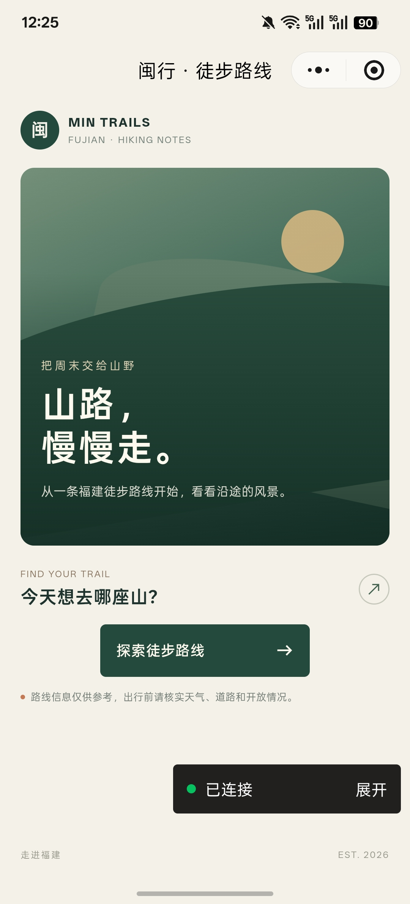
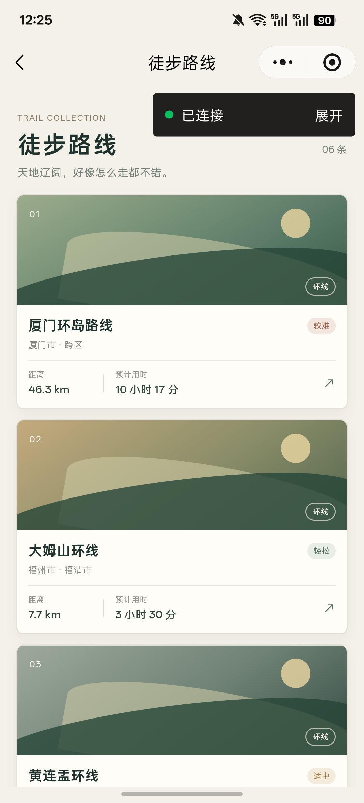
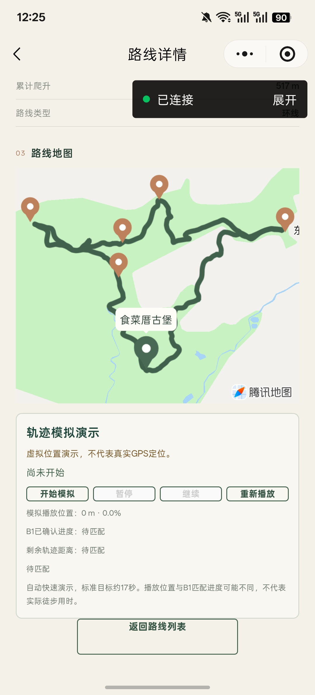

# 福建徒步地图

基于微信原生小程序与 CloudBase 的徒步路线浏览、前台真实GPS循迹、步行接驳与导航演示系统。

**V0.2是已完成的公开版本；本目录是V0.3发布候选准备源码，尚未微信正式发布。** 当前状态更新于2026-11-05。它展示实际地图、地理数据、算法和异步状态管理；不提供后台定位或专业安全导航保证。

## 项目缘起

项目源于个人户外徒步兴趣。项目所有者借这款小程序实践需求分析、PRD、功能边界、任务拆解、AI 辅助开发（Vibe Coding）、版本管理和真机验收。

## 当前实际完成情况

正常浏览包括：首页、六条路线列表与详情、绿色正式轨迹Polyline、起点Marker、Waypoint卡片和微信原生打开目标位置。V0.3从独立routes_v03只读加载，错误不回退V0.2旧routes。真实GPS与步行接驳实现保留，正式foregroundReleaseEnabled=false、accessRequestsEnabled=false；私人候选已取得005现场循迹及一次194点真实接驳蓝线证据，正式启用仍须单独审批。

模拟演示提供**播放、暂停、继续、重播**。当前稳定版本**没有 1x/2x/4x 倍率按钮，播放速度倍率调节未交付**。原计划中的调速不计入本次完成能力。

## 六条正式路线与两种演示模式

| ID | 路线 | 轨迹点 | Waypoint | 当前页面演示 |
| --- | --- | ---: | ---: | --- |
| fj-route-005 | 厦门环岛 | 1,004 | 7 | 完整 B1 虚拟 GPS 模拟 |
| fj-route-006 | 大姆山 | 735 | 5 | 完整 B1 虚拟 GPS 模拟 |
| fj-route-008 | 嵛山岛 | 7,035 | 4 | 原生 MapContext.moveAlong 路线速览 |
| fj-route-009 | 黄连盂 | 2,464 | 3 | 完整 B1 虚拟 GPS 模拟 |
| fj-route-010 | 太姥山 | 6,395 | 4 | 原生 MapContext.moveAlong 路线速览 |
| fj-route-011 | 小坪森林公园 | 1,834 | 4 | 完整 B1 虚拟 GPS 模拟 |

六套正式 Route 和对应 Import 均保留，公开再分发授权已由项目所有者确认。结构校验、算法回放、地图展示与实地通行属于不同验证层级；没有声称六条路线全部现场走通。来源与处理限制见[数据说明](docs/DATA_SOURCE.md)。

## 技术亮点

### B1 轨迹匹配、确认进度与合法完成资格

四条页面模拟从正式 Route.track 派生虚拟观测，真实调用既有 B1 引擎。它结合定位质量、时序、分支候选、合理推进和终点连续证据计算进度与完成资格，不用固定百分比动画伪装算法运行。演示开始后只显示一行播放进度。B1 匹配数据供内部验证，虚拟播放时间仅用于演示。

B1核心及六路线独立回放保留，包含旧算法预期失败的负控制。**六条路线真实GPS均使用同一B1核心；四条页面模拟与008/010原生速览是演示模式的差别，不限制真实GPS能力。** 自动化覆盖不等于六条路线均已现场通过，阈值的跨设备/场景校准仍有边界。

### 高密度长轨迹的原生分段速览

008/010 使用原生 moveAlong 沿正式几何分段播放，处理分段交接、暂停/继续、重播、异步移除、过期回调及页面生命周期。暂停在当前短段结束后生效，界面提示预计最多约 1 秒。010 保留第 15 段严格真实末点证据备用完成机制，要求有序行进、接近末点及 API 确认；不以计时到期替代完成，不扩展到 008 或最终第 16 段。

这两条是**可视化速览，不是实时 B1 匹配或真实 GPS**。针对微信地图渲染负载采用不同模式，是已验收的工程取舍。细节见[模拟与原生速览](docs/SIMULATION.md)。

### 地图、Navigation 与模块隔离

正式 Trail 与临时 Access 分离；Waypoint/Native、单次定位与云端高德规划各有边界。B1 纯算法、虚拟 GPS 会话和真实定位服务分模块保留，模拟不调用真实持续定位、不保存徒步历史。正式页面已集成独立真实GPS面板，用户主动开始后检查微信隐私与位置授权，通过真实SDK位置执行B1起点确认、质量过滤及进度状态机，并提供暂停、恢复、停止和清理失败保护。真实Marker使用SDK原坐标，不吸附路线；真实、模拟、Native与Access受资源互斥约束。

正式005已在新珍珠湾起点取得Android起点连续确认、following、同会话可信进度增长、静止冻结、非零进度暂停恢复及安全停止证据；后续正式CloudBase候选已完成偏航/回归及进度恢复专项。以上是用户现场反馈与脱敏标量证据，不是助手独立操作手机，也不是实际累计步行距离的精度保证。

尚未覆盖完整终点、其余五条路线现场表现、低精度/跳点专项现场及全部系统退出场景；不要求把未测场景写成通过。SDK停止契约与硬件物理停止分别判断，当前不采集/保存位置历史。

真实GPS已实现独立的release许可及既有身份/Route/权限/资源保护，当前许可严格false，正式版仍拒绝启动。Access阅读通道、逐次明示同意与一次性grant相互独立；policyPagePath=null为历史字段，不再代表阅读入口缺失。私人候选已真实规划成功，正式Access仍默认false；主体与平台账号事实保留OWNER_CONFIRMED/USER_REPORTED边界，不冒称平台独立核验或审核通过。

## 演示与现场准备

[演示指南](docs/PORTFOLIO_DEMO_GUIDE.md) · [现场验收手册](docs/V03_GPS_FIELD_ACCEPTANCE_RUNBOOK.md) · [GPS发布计划](docs/V03_GPS_RELEASE_PLAN.md)。手册包含阶段性历史，最新边界以[当前实施状态](docs/PROJECT_STATUS.md)为准。D3.2已通过自定义顶部返回、真实Native移除ACK及005跨页IDLE；D4.1 的 GPS 初始卡片、紧凑按钮与精简模拟卡片已获用户 Android 视觉验收。

## 技术栈与项目结构

微信原生小程序、JavaScript、WXML/WXSS、微信 map 与 MapContext（腾讯地图底图）、CloudBase、服务端高德步行规划、Node.js 本地测试；没有引入前端框架或独立业务后端。

~~~text
miniprogram/     三页面、地图资源、只读路线/接驳服务、B1及两种模拟模式
cloudfunctions/ planAccessRoute：身份校验、事务限频、服务端高德调用
data/routes/    六套正式 Route JSON 与对应 Import 源文件
scripts/        公开回归、算法回放及开发期离线转换工具
docs/           架构、运行安全、数据来源、测试和证据层级
~~~

[架构说明](docs/ARCHITECTURE.md) · [运行与安全](docs/RUNNING_AND_SECURITY.md) · [测试说明](docs/TESTING.md) · [验收与版本边界](docs/PORTFOLIO_STATUS.md) · [当前实施状态](docs/PROJECT_STATUS.md)

当前RC采用[95成员清单](RELEASE_FILES_V03_RC_DEFAULT_OFF.txt)，清单自身为构建控制文件，不计入其描述的95项。87成员内部清单及V0.2原清单均是受保护历史，不再当作最新RC成员集。候选构建与微信正式发布资格分别判断。

## 产品工作与AI辅助开发

项目所有者负责选题、路线与节点挑选、PRD、功能边界和产品决策，并制定验收方案、操作 Android 真机和完成现场验收。Codex 协助技术分析、代码实现与修复、自动化测试、构建和工程文档。

## 本地安装与运行

1. 安装 Node.js 与微信开发者工具。V0.2原验证环境为Node.js 24.19.0；当前回归环境以对应报告为准，项目配置基础库为3.17.3。其他环境需独立复验，不把版本号当作账号权限已开通。
2. 下载源码，在项目根目录先执行下方公开测试。Node 测试不需要安装小程序前端依赖、不调用真实云端或真实定位。
3. 在自己的私有运行副本配置三处：project.config.json 的 appid、miniprogram/config/env.js 的 cloudEnvId、cloudfunctions/planAccessRoute/index.js 的 APP_ID。前后端 AppID 必须属于同一使用者账号；占位值不能用于真实运行。
4. 登录自己的微信小程序账号，开发者工具导入项目根目录。miniprogramRoot=miniprogram/，cloudfunctionRoot=cloudfunctions/；V0.3使用独立routes_v03，不能修改公开V0.2旧routes来试运行。配置缺失或误指旧集合时失败关闭。
5. 新独立环境如确需导入，先按发布计划使用scripts/prepare-v03-route-release.cjs生成校验一致的单行导入包；先审查再由有权用户操作。已经验证的共享routes_v03不重复导入，也不把普通JSON和Import各导一遍。本仓库不自动写云端。
6. 正式GPS和Access默认关闭。自有账号使用真实服务仍需核对接口、隐私指引、第三方说明与适用许可，另行批准构建/启用/部署；不照抄项目所有者身份配置。高德Key仅存在云函数环境变量AMAP_WEB_SERVICE_KEY，浏览路线不需要Key；本轮未部署或改云数据。
7. 编译后应能进入首页、六路线列表与详情，看到绿色轨迹和节点；005/006/009/011出现B1模拟，008/010出现原生速览。首次独立账号/云环境的完整导入、编译、权限拒绝与接驳流程仍标记“待独立环境复验”。

详细数据库规则、服务端配置、导入清单与错误处理见[运行与安全](docs/RUNNING_AND_SECURITY.md)。不要使用项目所有者的云资源，不要用关闭鉴权或关闭 urlCheck 代替有效环境配置。

## 自动测试

在项目根目录执行：

~~~sh
node scripts/check-public-routes.cjs
node scripts/check-trail-simulation-page.cjs
node scripts/check-native-route-overview.cjs
~~~

公开Runner配置20项，使用隔离TEMP副本验证依赖闭合。D4实际运行20项全部通过，其中Follow122组（原116+6组用户UI）、Native44组、页面模拟19组保留；六路线数据、GPS、Native、接驳均使用既有测试体系，不访问真实CloudBase/定位/高德。单行云导出格式由发布导出校验单独检查，多行源JSON使用校验器已有的显式文件模式。

这些是本地自动验证，不是设备地图渲染、真实 GPS 或微信审核成绩；脚本中的历史日期/手工验收 PENDING 文本不代替实际运行日期或最新人工记录。详见[测试说明](docs/TESTING.md)。

## 真实设备验收与限制

以下为V0.2历史用户验收，不代表V0.3完整导航验收：六路线演示已由用户在电脑微信开发者工具与 Android 按不超过20秒的作品集标准接受。最终文案、006/010控制横排及短播、正常地图/Waypoint/Native/Access响应、返回重进也已获双端用户确认；助手没有把用户确认提升成独立设备实测。四条B1没有逐条精确秒数或原始运行时B1摘要；本轮没有独立复核实时Access的成功蓝线/受限提示细分。

- 008/010特殊重播/退出操作存在已条件接受的 faceTo 渲染层 Console 警告：**尚未修复，也未由官方确认是SDK Bug**；不是商业全平台零错误保证。
- V0.3正式GPS和Access许可仍false；私人候选的真实GPS与194点接驳通过不等于正式用户已开放。用户要求的范围为前台循迹，不开发锁屏/后台持续定位。
- 当前账号接口和隐私用途已有所有者确认，属于OWNER_CONFIRMED，正式平台一致性仍未独立核验。GitHub公开源码、本地运行和微信审核上线分别判断；没有宣称已获微信官方审核或正式上线。
- 轨迹及难度/时长为展示参考，当前通行条件需另核实，不承诺所有路段可走。

## 真实截图与作品集证据

以下为用户提供的历史Android实际运行截图，保留“已连接”调试浮层，展示的是历史界面。D4.1 视觉验收另有用户真机反馈。只移除EXIF元数据，画面像素、尺寸及色彩配置不变；未生成、重绘或裁切界面。

<table>
<tr><td></td><td></td><td></td></tr>
<tr><td>首页</td><td>六路线列表（上半）</td><td>B1模拟面板（尚未开始）</td></tr>
</table>

[全部5张截图与证据边界](docs/SCREENSHOTS.md)包含列表下半、正式绿色轨迹、Start与Waypoint。地图截图保留腾讯地图归属；没有纳入可能关联个人位置的Access或“距你”画面。

现有B1截图处于尚未开始状态，不是动态完成证据；当前没有010原生速览截图或录屏。动态与双端交互结论来自已披露的用户验收及本地自动测试，不由静态图片补造。

## 后续计划与数据边界

V0.2已公开；V0.3已具备真实前台GPS及受控接驳实现与分层验收证据。D4.1 新增视觉验收已完成。源码提交、GitHub 推送、正式功能启用和微信审核发布分别审批。启用前核对正式账号类目、定位权限、隐私声明、第三方数据披露及云环境配置。

公开内容不含私人AppID、运行云环境、高德Key、个人定位历史、原始GPX、Seed/Mock、私人验收日志或QA专用测试配置。只保留经审查的历史算法文本供负控制。既有数据来源与代码许可声明保留；六路线授权不等于全部源码授予统一开源许可。
