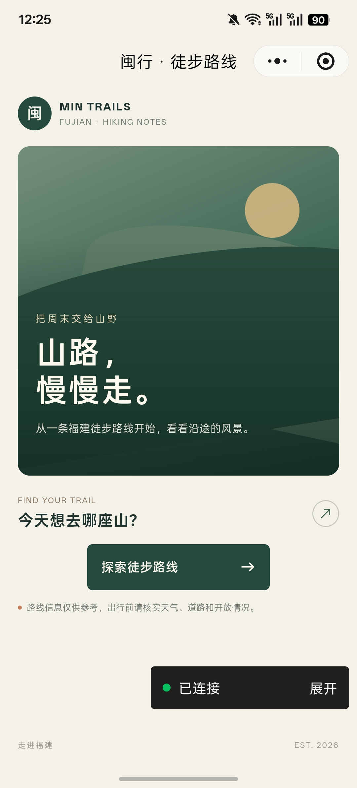
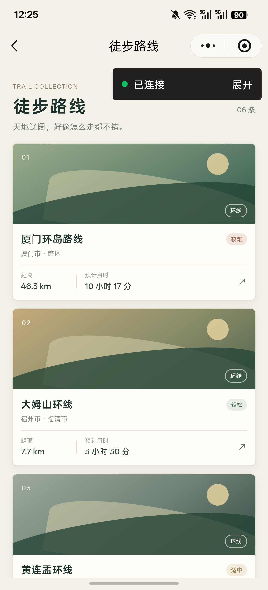
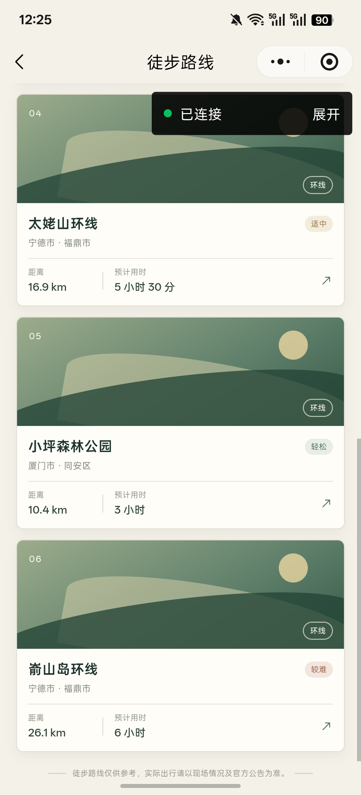
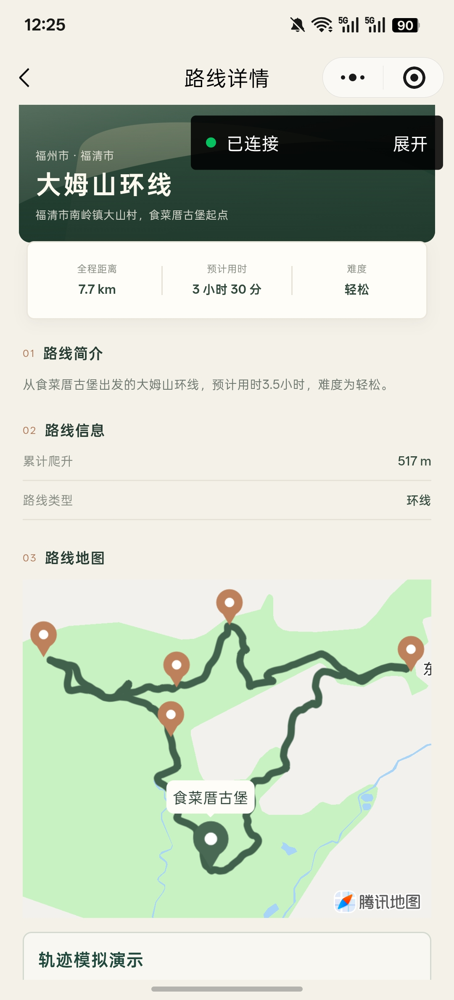
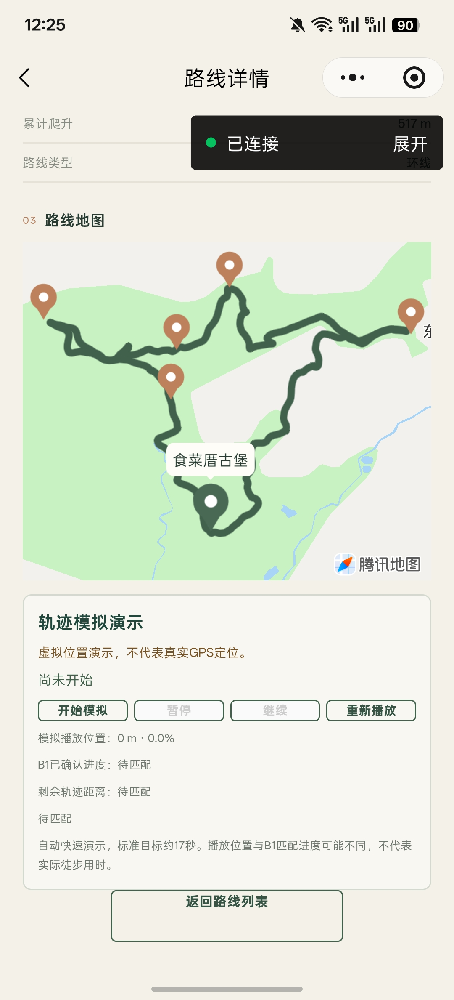

# 当前Android实际运行截图

这些图片来自用户提供的当前最终功能版实际截图；没有用生成图、旧版本图片或修改界面冒充验收。截图保留“已连接/展开”远程调试浮层、系统状态栏和原画面，不能据此声称微信官方上线或商业发布。

公开副本只移除EXIF元数据，其中包含不必要的图像唯一标识。JPEG图像编码数据与ICC色彩配置保持，5张逐个解码比较后的显示像素完全一致，尺寸均为1080×2376。没有裁切、遮挡、抹除调试浮层或重绘。用户桌面原件保持不变。

## 首页

## 六路线列表

上半显示厦门、大姆山及黄连盂条目开头；下半显示太姥山、小坪森林公园及嵛山岛。

## 大姆山路线详情、正式轨迹及节点

绿色Trail、起点与Waypoint是正式路线数据的地图展示，腾讯地图归属保留；这不是用户实际徒步位置。

## 大姆山B1模拟面板（尚未开始）

图片展示播放/暂停/继续/重播及B1确认进度字段，状态为尚未开始。不能用它证明动画已完成或实际GPS匹配。

## 素材范围与不足

- 没有在公开候选放入可能关联用户当前位置的接驳线路或原生地图“距你”图片。
- 没有010原生速览截图、运行中/完成态B1截图或录屏；这些可以以后实际补采，不生成替代。
- 现有图片证明当前界面与地图可见，不代替六路线双端用户验收、运行时B1摘要或真实户外GPS验证。
- 两原生四B1及已知faceTo限制见[模式说明](SIMULATION.md)和[证据层级](PORTFOLIO_STATUS.md)。
