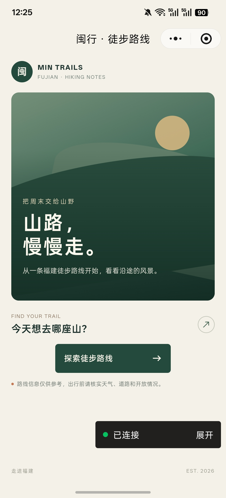
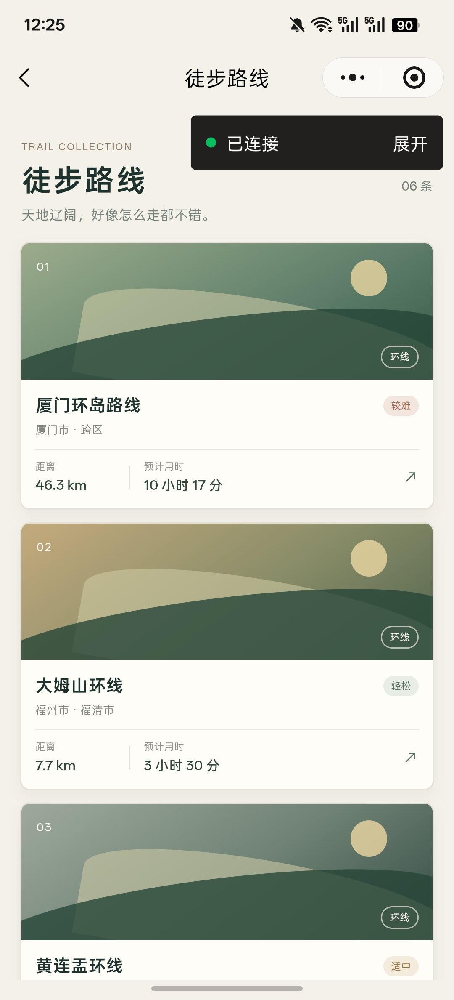
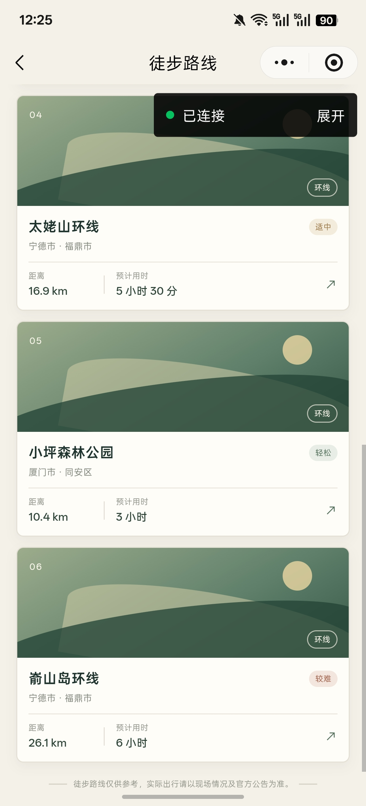
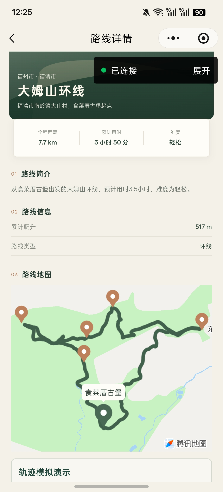
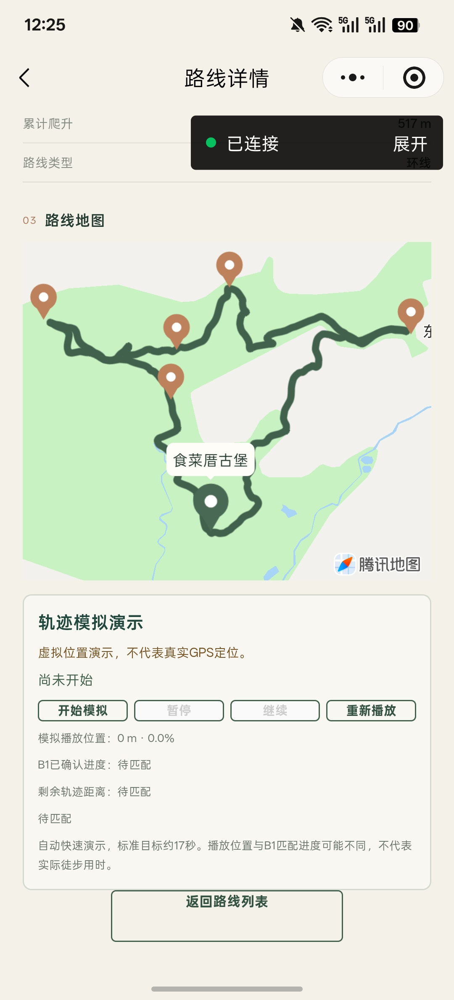
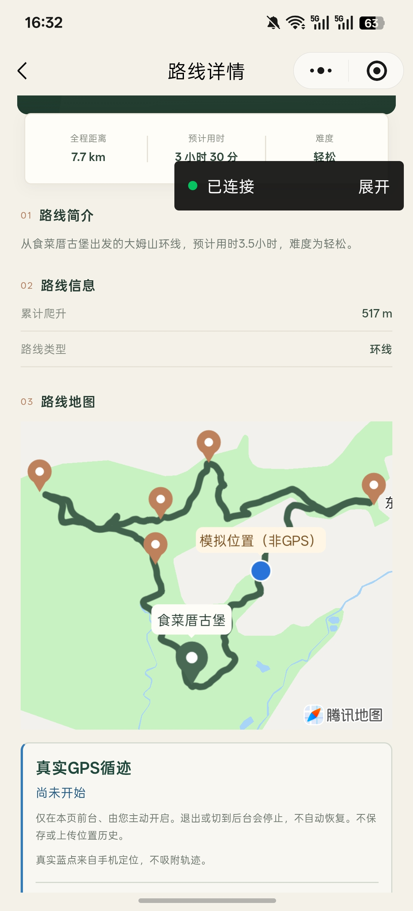
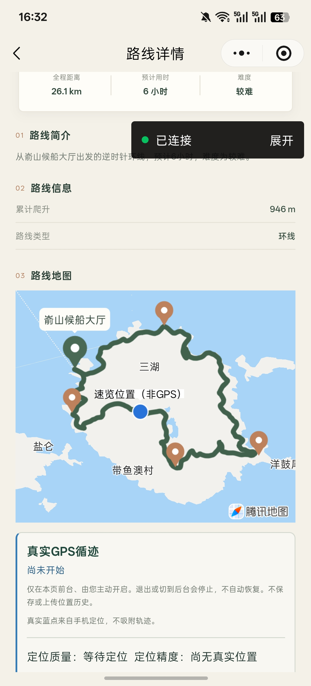
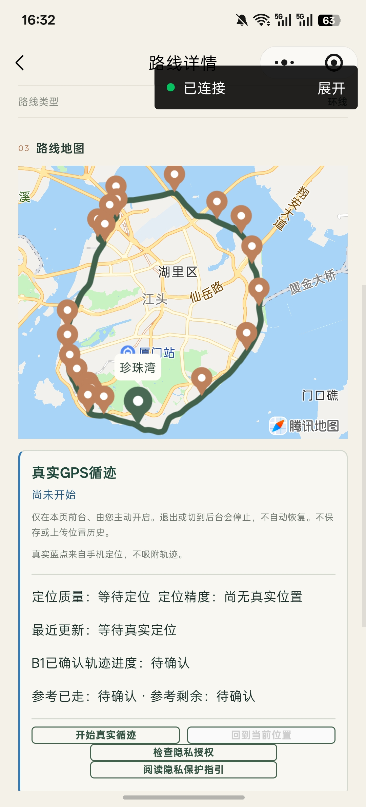

# 福建徒步地图
## 从路线浏览到轨迹演示：一次AI辅助产品交付实践

**产品经理／AI产品经理实习作品集 · v3**

## 项目概览

福建徒步地图帮助使用者查看福建徒步路线、理解路线走向，并了解沿途关键位置。产品采用微信小程序，已经完成六条路线的地图展示和可重复播放的轨迹演示；公开V0.2之外，V0.3正在内部验证真实前台GPS能力。

项目最有代表性的决策，发生在真实GPS开发出现Bug、面试临近的时候：我先交付路线展示与模拟导航，争取稳定可展示的成果，再继续推进真实GPS。后续长路线性能分流和开放范围管理，是在这一优先级调整之后作出的进一步取舍。

|项目要素|当前情况|
|---|---|
|产品形态|微信原生小程序，CloudBase路线数据服务|
|公开成果|V0.2，六条正式路线、地图与节点、四条算法模拟和两条原生速览|
|内部探索|V0.3 前台 GPS、会话状态与第三方请求准入，源码功能分支已公开，尚未微信正式发布|
|AI的作用|ChatGPT辅助讨论和组织材料；实际代码由Codex完成。产品本身未集成大模型|
|我的职责|选择路线、制作PRD、明确需求和功能边界，借助Codex拆解任务、组织测试验收，判断版本目标和交付优先级|

我负责产品定义、任务组织与交付判断，实际coding由Codex完成，包括小程序、导航算法相关实现和云函数代码。本文不把这些实现写成我的独立编程成果。

## 用户场景与产品目标

我平时经常进行户外徒步，每次都需要寻找路线和地图。这是选题的直接来源。我知道两步路等成熟户外路线App已经存在，制作这个小程序并不是为了立即取代它们，而是想结合个人兴趣，实践Vibe Coding的完整过程和项目管理，并做出能够展示路线、地图与导航能力的实际作品。

从使用任务看，出发前需要了解起点、路线走向和关键节点。项目围绕这些任务组织首页、列表和详情，让使用者先理解路线，再打开目标位置。

这段个人经历说明了选题与我的关系，但不是市场调查或用户访谈。对于其他徒步使用者，需求强度、使用规模和付费意愿仍是未充分验证的假设；目前主要验证了产品功能和演示可用性。

作品集还有一个明确的展示场景：面试官无需到福建现场，也能通过播放、暂停、继续和重播理解轨迹能力。这个场景决定了模拟演示需要与正常浏览分开，也需要准确说明演示和真实定位的区别。

## MVP与版本迭代

下表回顾实际形成的版本，不代表一开始就预设了独立模拟导航阶段。最初推进的是真实GPS；遇到Bug并临近面试后，才调整为先交付路线展示和模拟导航。

|版本|优先解决的问题|交付边界|
|---|---|---|
|V0.1 基础产品|先完成路线资料、云读取、地图和节点浏览|把数据与界面连成可使用的流程，保留已有单次接驳能力|
|V0.2 公开交付|让轨迹能力可交互、可重复展示|六条正式路线；四条B1模拟、两条Native速览；播放、暂停、继续、重播，无倍率控件|
|V0.3 发布候选|验证前台 GPS 和受控接驳|正式 005 核心现场及对应专项已完成阶段性 Android 验收，完整终点及其余五条路线现场仍待验证。正式 GPS 与 Access 默认关闭|

## 产品功能与真实界面

### 1. 先浏览路线，再查看地图与关键位置

首页进入六路线列表，卡片提供路线概要；详情页展示绿色正式轨迹、起点和Waypoint关键节点。点击节点可以查看卡片，并通过微信原生地图打开目标位置。正常浏览不要求先启动模拟。

*首页提供明确的路线入口。本节首页、两张列表及大姆山地图图为此前已公开审查的V0.2时期Android实际截图；下一节的未启动模拟面板图也沿用该批素材。新增的三张Android截图另行标注，包含V0.3内部界面。图片保留调试连接浮层，均不代表微信正式审核上线。*

|六路线列表上半|六路线列表下半|
|---|---|
|||

当前正式路线为厦门环岛、大姆山、嵛山岛、黄连盂、太姥山、小坪森林公园。

*006大姆山的绿色轨迹、起点与Waypoint。保留腾讯地图归属，当天路段可通行情况需实际查询。*

### 2. 两种演示方式，分别承担不同任务

B1可以理解为“把一系列位置与路线进行匹配，判断沿线进度及是否满足完成条件”的算法。四条路线使用沿正式轨迹生成的虚拟位置，让使用者观察播放位置、确认进度和剩余距离。动画走到哪里与算法确认到哪里分别呈现。

Native速览使用微信地图的原生动画，沿正式轨迹快速展示路线走向。它适合高密度路线展示，但不执行页面实时B1匹配。

|正式路线|当前页面演示|
|---|---|
|005 厦门环岛、006 大姆山、009 黄连盂、011 小坪森林公园|完整B1虚拟GPS模拟|
|008 嵛山岛、010 太姥山|Native原生路线速览|

*现有图处于“尚未开始”，可展示控制和进度字段，不作为动态运行或到达终点的证据。*

*新增Android实拍：006大姆山的绿色轨迹、Waypoint与蓝色“模拟位置（非GPS）”标记同屏可见。本图未同屏显示B1已确认进度数值，不作为进度计算正确、动态连续运行或完成路线的独立证据。下方真实GPS面板显示“尚未开始”。*

*新增Android实拍：008嵛山岛的绿色轨迹、Waypoint与蓝色“速览位置（非GPS）”标记同屏可见。本图未同屏显示Native播放控制按钮，也不能单凭静态画面证明播放、暂停或继续的行为；这些能力仍以既有实现和验收记录为依据，不将速览位置解释为真实GPS或页面实时B1匹配。*

### 3. 内部候选中的真实GPS与接驳边界

V0.3已有主动启动的前台GPS面板和状态管理，但release版本仍不能启动真实GPS。V0.3 正式 Access 仍关闭。私人候选曾验证一次接驳蓝线，政策阅读、单次授权和请求许可保持独立。V0.2的既有单次接驳实现，与V0.3当前是否允许发起真实请求，是不同版本状态。

*新增Android实拍：V0.3内部候选的精简GPS面板显示“尚未开始”，定位质量为“等待定位”、定位精度为“尚无真实位置”，最近更新和B1进度仍待确认。本图证明未启动界面的呈现，不证明真实GPS运行、正式路线现场验收或release版本已开放；可见按钮也不等于公开版本允许启动。*

*三张新增截图均保留“已连接／展开”调试浮层及腾讯地图署名。地图中的路线与节点用于功能展示；模拟位置和速览位置均非用户实时GPS。*

## 核心产品决策：GPS受阻时，先交付可展示的成果

### 初始目标

最初我希望推进真实GPS功能，并没有预先设计一个独立的模拟导航阶段。路线和地图是产品基础，真实GPS是当时准备继续实现的能力。

### Bug与面试期限带来的约束

开发过程中出现了明显Bug，而距离一次面试已经很近。我判断，如果继续把精力集中在真实GPS修复上，可能来不及得到稳定的展示成果。这里不补写Bug根因、具体日期或修复耗时；这次决策的个人背景来自我本人的确认。

### 当时的选择

一个选择是继续优先修真实GPS，把面试展示押在修复结果上；另一个选择是先收拢交付范围，让路线展示与模拟导航形成可操作的成果，再继续真实GPS开发。后者并不等于真实GPS问题已经解决，也不需要把模拟包装成真实定位。

### 为什么先交付展示与模拟

我重新判断了项目当时的目标：更重要的是展示产品思路和一件实际作品，而不是立即交付专业户外导航工具。因此，我主动把路线展示与模拟导航调到优先位置。面试官可以在不去正式路线现场的情况下操作产品，我也能明确讲清已经完成的能力与尚缺的验证。

### Codex执行与我的验收

我明确新的需求边界和交付优先级，在Codex协助下拆解任务、组织测试与验收；实际代码由Codex完成。调整后的实现保留正式路线与进度计算，形成播放、暂停、继续和重播的交互演示。后续遇到高密度路线性能问题，再作四B1、两Native分流，这与最初增加模拟导航不是同一次决策。

我通过实际设备操作和反馈检查展示成果。既有V0.2有双端用户验收记录；最新Android排练再次覆盖正常浏览、006 B1和008 Native。这里的设备证据是用户反馈，不是独立设备取证，也不补造当次面试效果或录屏数据。

### 后续真实GPS开发

模拟交付之后，项目继续修复部分真实GPS开发问题，逐步实现了受控的前台GPS和状态管理。正式 005 已有 Android 核心现场、同会话进度和偏航回归证据，完整终点和其余五线现场仍待验证。六路线离线回放覆盖六条正式路线，release GPS 仍默认关闭。V0.3没有正式公开发布真实GPS能力。

### 复盘

这次调整让我把阶段目标与长期能力分开：面试前先交付能准确展示的成果，后续再继续处理真实GPS，而不是等待所有问题一起解决。模拟导航是明确标识的交互方式，没有被用来掩盖真实GPS尚未完成的部分。

## 后续实现取舍与上线范围管理

### 实现取舍：长路线采用Native，保留四条B1模拟

**实际问题。** 本地算法回放通过后，微信端仍出现更新缓慢和观测积压；手机交互成本不能由Node测试时间代替。

**目标与约束。** 需要让面试演示可操作，同时保留正式轨迹、算法与测试。嵛山岛有7035个轨迹点，太姥山有6395个点，不能为演示方便换成虚构短路线。

**可选方案。** 继续让所有路线使用B1页面并优化更新，或按路线规模拆分演示机制。历史上已尝试合并同快照更新等优化，但没有因此直接确认真实端达标。

**负责人确认的决策。** 四条较短路线继续展示完整B1，高密度的008、010采用原生分段速览；独立B1回放仍覆盖六条。

**执行与验证。** 实现保留正式几何与顺序，并处理原生动画的分段、暂停、继续和清理。既有双端验收支持原版本展示；最新Android排练再次覆盖006 B1和008 Native，结论来自用户报告，没有补造独立录屏或精确耗时。

**结果与复盘。** 同一产品允许不同技术路径，只要任务和证据边界清楚。这里保住了演示覆盖和算法成果，也明确放弃“六条页面全部实时B1”的表述。已知faceTo特殊操作警告仍按既有范围披露，尚未修复。

### 开放范围管理之一：真实GPS分阶段验收，保留release安全门

**实际问题。** 真实位置可能不准、断流或跳变；收到首位置、形成可信进度和完整结束会话，需要分别验证。

**目标与约束。** 在开发与体验环境中逐步验证能力，同时避免把未完成现场验证的导航开放给公开版本。

**可选方案。** 依据局部成功就开放，或把内部验证与release准入分开。当前采用后者。

**负责人确认的决策。** 保留主动启动、授权检查、位置质量与生命周期保护，release继续阻断。面板文案可以简化，但不能连同底层条件一起放松。

**执行与验证。** 正式005已有Android首位置、起点保护及停止回执证据；私人Nearby有局部连续进度与暂停恢复证据。最新八项面板精简也获得用户可视接受，但这些材料不能合成正式路线现场通过。

**结果与复盘。** 正式路线following、沿线进度、偏航与终点仍待现场验证。项目把“实现”“局部可验证”和“可公开开放”分开管理，后续开放应由缺失证据决定，而不是由按钮是否存在决定。

### 开放范围管理之二：Access完成基础契约后，仍选择暂缓真实接驳

**实际问题。** 从当前位置规划到节点会向第三方发送位置信息。打开政策、明确同意一次操作、允许真实请求，不能互相替代。

**目标与约束。** 保留未来接驳能力，同时明确用户意图、第三方数据使用及平台准入边界。

**可选方案。** 继续推进真实联调，或先保留阅读与授权机制、暂缓真实请求，把当前交付聚焦到可稳定展示的部分。

**负责人确认的决策。** 选择暂缓真实Access，生产请求开关保持关闭，不因已经完成工程就自动开放。

**执行与验证。** 阅读通道、当次明示同意和真实请求许可已分层实现；政策阅读有用户Android验证。账号状态来自所有者确认，部署包与控制台资料支持只读边界核对，尚不等于真实请求或线上事务验证。

**结果与复盘。** 需求和接口成果保留，真实调用暂缓。客户端关闭也不等于共享云函数已经全局停用。后续是否开放，仍须结合平台条件、明确授权和受控验证决定。

## AI辅助开发与项目管理

本项目使用ChatGPT辅助范围讨论和材料组织，使用Codex辅助实现、检查和测试。00–09共十个工作线程分别承担项目控制、页面、云服务、数据、地图、导航、路线扩展、QA与发布工作；其中03负责早期路线资料、来源追溯和数据质量审查。这些是AI协作线程，不是十人的研发团队。

我选择徒步路线、制作PRD、明确产品需求和功能边界，并在Codex协助下拆解开发任务、组织测试和验收，判断版本目标和交付优先级。真实GPS受阻时先交付模拟，是其中最能代表我本人判断的一次调整。

实际代码由Codex完成。我对产品目标、范围和验收作判断，不把导航算法、小程序或云函数描述成自己独立编写，也不把自己的参与缩减成单纯输入Prompt。

每轮任务需要说明可改范围、保护对象和验收条件；AI产出再经测试和人工反馈决定是否进入下一阶段。对AI产品经理岗位而言，这个项目提供的是组织AI工作流、审查输出和承担交付判断的案例，产品本身没有集成大模型。

## 验证结果

|已形成的成果|证据能支持的范围|
|---|---|
|V0.2公开交付|六路线、地图节点、交互演示与可审核源码；不等于微信正式审核上线|
|B1与Native演示|既有本地回归及用户设备反馈；最新排练覆盖正常浏览、006和008|
|V0.3 GPS局部能力|正式005与私人Nearby各自范围的Android证据；不能替代正式路线全程验收|
|最新GPS面板|八项UI调整有用户可视接受；未因此增加现场GPS或测距证据|
|Access边界|三层契约、阅读及部分云端核对成立；真实请求仍暂缓|

本地测试、用户设备反馈和正式路线现场验证各有边界。上述设备结果来自用户报告，不是独立设备取证；本稿没有把不同阶段测试组数相加，也没有新增本轮测试成绩。

## 复盘与后续方向

当前成果验证了路线浏览、交互演示和分阶段交付的可行性，没有已证明的活跃用户、留存、收入或导航准确率。下一阶段需要分别判断真实用户需求、正式路线现场证据和第三方服务开放的价值与成本。

项目的产品经验在于：当目标超过当前条件时，先保留最有价值、可解释的交付，再将缺口变成可验证的后续条件。选题来自我持续的徒步兴趣，最有代表性的判断是面对GPS Bug与面试期限重新安排交付优先级。对外叙述仍以当时的选择和现有证据为限，不补造具体Bug根因、修复时长或面试结果。
